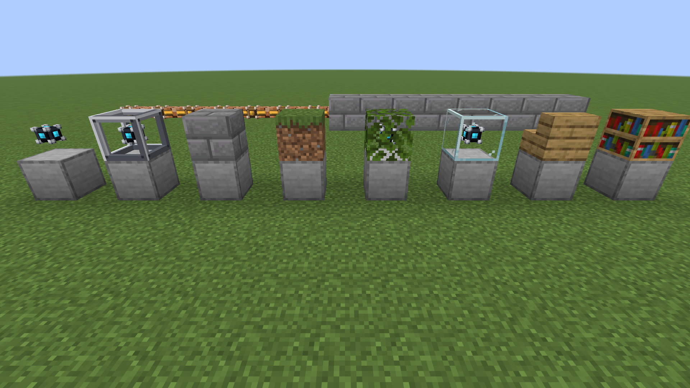

Tired of cables snaking across your base? **Cable Cloak** lets you hide them inside a facade that looks like any block you want, vanilla or modded, without touching how the network works.

Currently supports the cables of [OmniVault](https://modrinth.com/mod/omnivault): Nexus Cable and Inventory Cable, in every colour.

## How to use

1. **Craft Cloak Frames**: 4 sticks in the corners and 4 iron nuggets on the sides give 8 frames.
2. **Put a frame on a cable**: right-click the cable with a Cloak Frame. It becomes a full, solid block with an iron frame around the cable.
3. **Give it a look**: right-click the frame with **any block**. Stone bricks, planks, grass, leaves, glass, stairs, blocks from other mods: the facade copies the block's model, colours and orientation. One block is used up.
4. **Change it**: right-click with another block to swap the look. You get the old block back.
5. **Take it off**: sneak + right-click with an empty hand removes the look, a second time removes the frame. Breaking the cable drops the frame and the block too.

## Good to know

- The cable keeps working as normal: connections, networks and dyeing (right-click with a dye) are unchanged.
- See-through blocks (glass, leaves) and partial blocks (stairs, slabs) show the cable inside.
- Want to build against a facade? **Sneak** while placing the block.
- Blocks drawn by a special renderer (chests, signs, beds…) and invisible blocks can't be used as a look.

## Requirements

- [Fabric API](https://modrinth.com/mod/fabric-api)
- [OmniVault](https://modrinth.com/mod/omnivault)

Install on both client and server.
